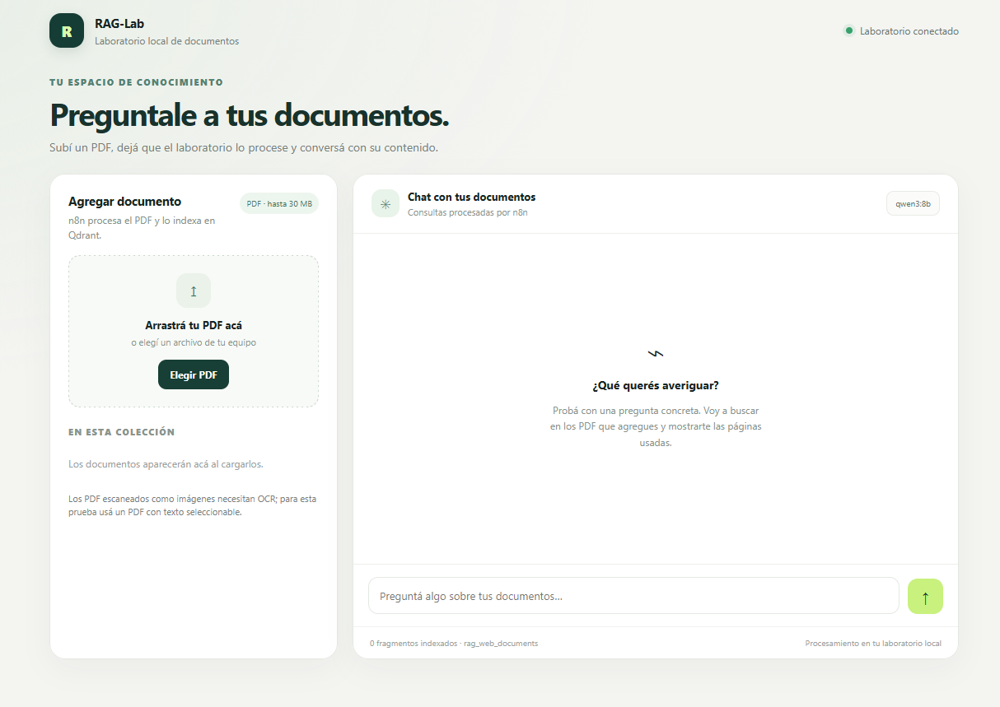
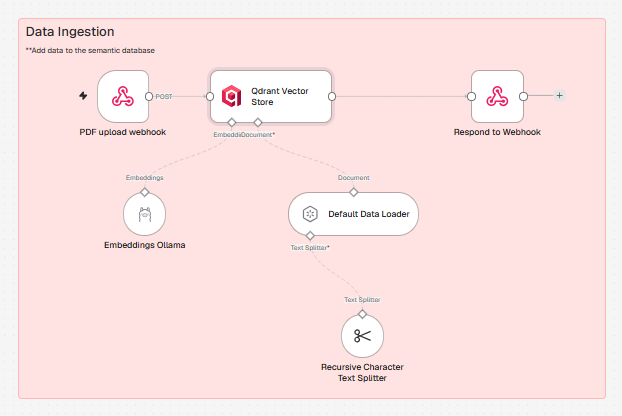
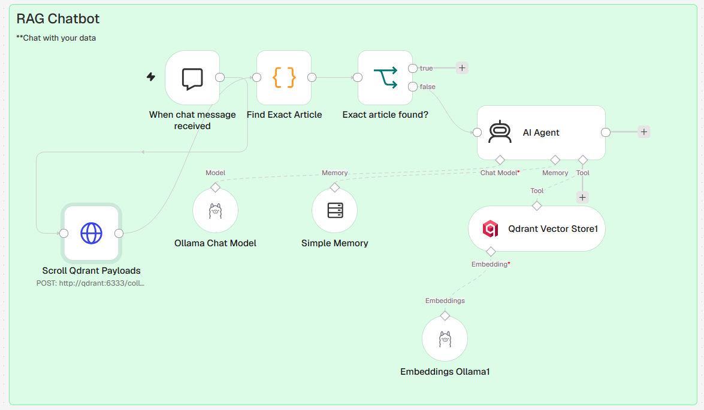
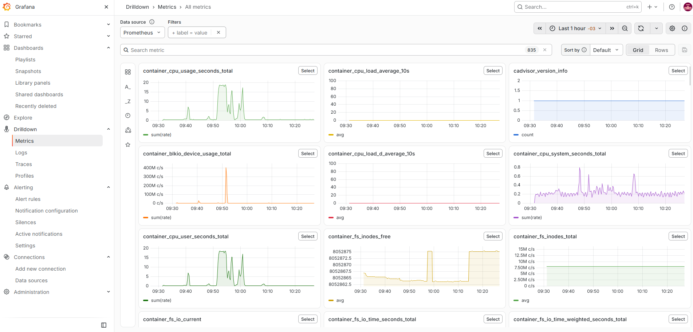

# RAG-Lab-Docker

Laboratorio local para aprender, probar y observar un sistema de generación aumentada por recuperación (RAG). Permite cargar documentos PDF, indexar su contenido y conversar con ellos desde una interfaz web. La carga y las consultas pasan por workflows de n8n; los modelos se ejecutan localmente con Ollama y los fragmentos se guardan en Qdrant.

El proyecto también incluye monitoreo de métricas y logs con Prometheus, Grafana, Loki y Grafana Alloy.



## Qué permite hacer

- Cargar un PDF con texto seleccionable de hasta 30 MB.
- Extraer su texto, dividirlo en fragmentos y generar embeddings localmente.
- Guardar y recuperar fragmentos semánticamente en Qdrant.
- Consultar los documentos en español y recibir respuestas con referencias al archivo y página.
- Enviar tanto la indexación como el chat a workflows de n8n.
- Observar métricas de n8n, Ollama, PostgreSQL, Prometheus y contenedores, además de logs centralizados.

El objetivo es un entorno de laboratorio para uso local. No está configurado como servicio público ni multiusuario.

## Componentes

| Componente | Función |
|---|---|
| **RAG Web (FastAPI)** | Interfaz para cargar PDFs y consultar la colección; muestra estado de los servicios y fuentes recuperadas. |
| **n8n** | Orquesta los workflows de ingesta y chat, conecta el cargador, el modelo de embeddings, Qdrant y el modelo de lenguaje. |
| **Ollama** | Ejecuta localmente `nomic-embed-text` para embeddings y `qwen3:8b` para generar respuestas. |
| **ollama-metrics** | Expone métricas adicionales de solicitudes, tokens, latencia, modelos y memoria de Ollama para Prometheus. |
| **Qdrant** | Base de datos vectorial que almacena fragmentos, vectores y metadatos de origen/página. |
| **PostgreSQL** | Base de datos de n8n para workflows, ejecuciones y configuración persistente. |
| **Prometheus** | Recolecta métricas de los servicios configurados. |
| **Grafana** | Presenta paneles y permite explorar métricas y logs; Prometheus y Loki se aprovisionan como fuentes de datos. |
| **Loki** | Almacena los logs de contenedores. |
| **Grafana Alloy** | Lee logs del runtime de Docker y los envía a Loki. |
| **cAdvisor** | Recopila métricas de uso de recursos de los contenedores, incluido Ollama. |
| **postgres-exporter** | Convierte estadísticas de PostgreSQL en métricas para Prometheus. |

## Cómo fluye la información

1. La persona carga un PDF desde la interfaz web.
2. La web lo envía al webhook de ingesta de n8n.
3. El workflow extrae el texto, lo divide en fragmentos, solicita embeddings a Ollama y los almacena en Qdrant.
4. La pregunta del chat llega al webhook del workflow de consulta de n8n.
5. El workflow recupera fragmentos relevantes de Qdrant y pide a Ollama una respuesta basada en ese contexto.
6. La web muestra la respuesta y las fuentes recuperadas.





## Servicios locales

| Servicio | Dirección |
|---|---|
| RAG Web | <http://localhost:8000> |
| n8n | <http://localhost:19676> |
| Grafana | <http://localhost:3000> |
| Prometheus | <http://localhost:9090> |
| Qdrant | <http://localhost:6333/dashboard> |
| Ollama API | <http://localhost:11434> |
| Loki API | <http://localhost:3100> |

Las credenciales de n8n, Grafana y PostgreSQL se configuran en `.env`. Dentro de n8n, creá credenciales de Ollama con la URL `http://ollama:11434` y de Qdrant con `http://qdrant:6333`, y asígnalas a los nodos de modelo, embeddings y vector store. Esas direcciones internas funcionan entre contenedores; no uses `localhost` en esas credenciales.



## Requisitos

- Docker Desktop con Docker Compose.
- Espacio libre para las imágenes, los modelos y los datos persistentes.
- Para acelerar la generación, una GPU compatible configurada para Docker/Ollama. Sin GPU puede funcionar en CPU, con mayor latencia.

## Preparación y primer inicio

1. Cloná o descargá el repositorio y entrá a la carpeta `RAG-Lab-Docker`.
2. Copiá `.env.example` a `.env` y reemplazá los valores de contraseña y `N8N_ENCRYPTION_KEY` por valores largos, aleatorios y propios. En PowerShell: `Copy-Item .env.example .env`. No publiques `.env`.
3. Iniciá los servicios:

   ```powershell
   docker compose pull
   docker compose up -d --build
   ```

4. Descargá los modelos usados por los workflows:

   ```powershell
   docker compose exec ollama ollama pull nomic-embed-text
   docker compose exec ollama ollama pull qwen3:8b
   ```

5. En n8n, importá `RAG-Lab-PDF-Upload.json` y `RAG-Lab-Web-Chat.json` desde `n8n/workflows-public/`. Creá las credenciales de Ollama (`http://ollama:11434`) y Qdrant (`http://qdrant:6333`) y asígnalas a los nodos de ambos workflows.
6. Activá los dos workflows. Sus rutas deben ser las indicadas en `.env.example`. Si n8n muestra otras rutas, actualizá `N8N_CHAT_WEBHOOK_URL` o `N8N_INGEST_WEBHOOK_URL` en `.env` con la URL interna correspondiente (`http://n8n:5678/...`) y recreá la web: `docker compose up -d --force-recreate rag-web`.
7. Abrí <http://localhost:8000>, cargá un PDF y probá una consulta.

El modelo de embeddings y el modelo de chat pueden requerir memoria de GPU/CPU según se ejecuten. En una GPU de 12 GB, la disponibilidad simultánea depende de la cuantización, el contexto y la configuración de Ollama.

## Monitoreo

Grafana está en <http://localhost:3000>. Las credenciales se definen mediante `GRAFANA_USER` y `GRAFANA_PASSWORD` en `.env`. Prometheus se encuentra en <http://localhost:9090>; las fuentes Prometheus y Loki se cargan automáticamente en Grafana.

Prometheus recolecta métricas de n8n, Ollama mediante `ollama-metrics`, PostgreSQL mediante `postgres-exporter` y Docker mediante cAdvisor. Alloy descubre contenedores y envía sus logs a Loki.

## Estructura del proyecto

```text
.
├── alloy/                 # Recolección y envío de logs
├── docs/screenshots/      # Capturas de la interfaz, workflows y monitoreo
├── grafana/provisioning/  # Fuentes de datos de Grafana
├── n8n/workflows-public/  # Workflows limpios para importar y compartir
├── prometheus/            # Configuración de recolección de métricas
├── rag-web/               # Aplicación web Python y contenedor
├── compose.yaml           # Servicios, redes, puertos y volúmenes
├── .env.example           # Plantilla de variables sin secretos
└── .gitignore
```

## Comandos útiles

```powershell
docker compose ps
docker compose logs -f n8n
docker compose logs -f rag-web
docker compose down
```

`docker compose down` conserva los datos en volúmenes. Evitá `docker compose down -v` salvo que quieras borrar también las bases y modelos persistidos.

## Alcance y limitaciones

- La interfaz acepta PDF con texto seleccionable. Los documentos escaneados requieren OCR antes de la carga.
- Los servicios están pensados para acceso local de confianza; no expongas estos puertos directamente a Internet.
- Los workflows de `n8n/workflows-public/` no contienen credenciales personales: cada persona debe crear las suyas y asociarlas al importar.
- El comportamiento de métricas de contenedores y GPU depende de Docker Desktop/WSL2 y de la configuración local.
- Las respuestas dependen de la calidad del texto extraído, la división en fragmentos, el modelo y el contexto recuperado; conviene verificar las fuentes.

## Capturas

Las imágenes de `docs/screenshots/` muestran la interfaz web, los dos workflows y Grafana. Ver [docs/screenshots/README.md](docs/screenshots/README.md) para el detalle de cada captura.

## Licencia

Este proyecto se distribuye bajo la licencia [MIT](LICENSE).
